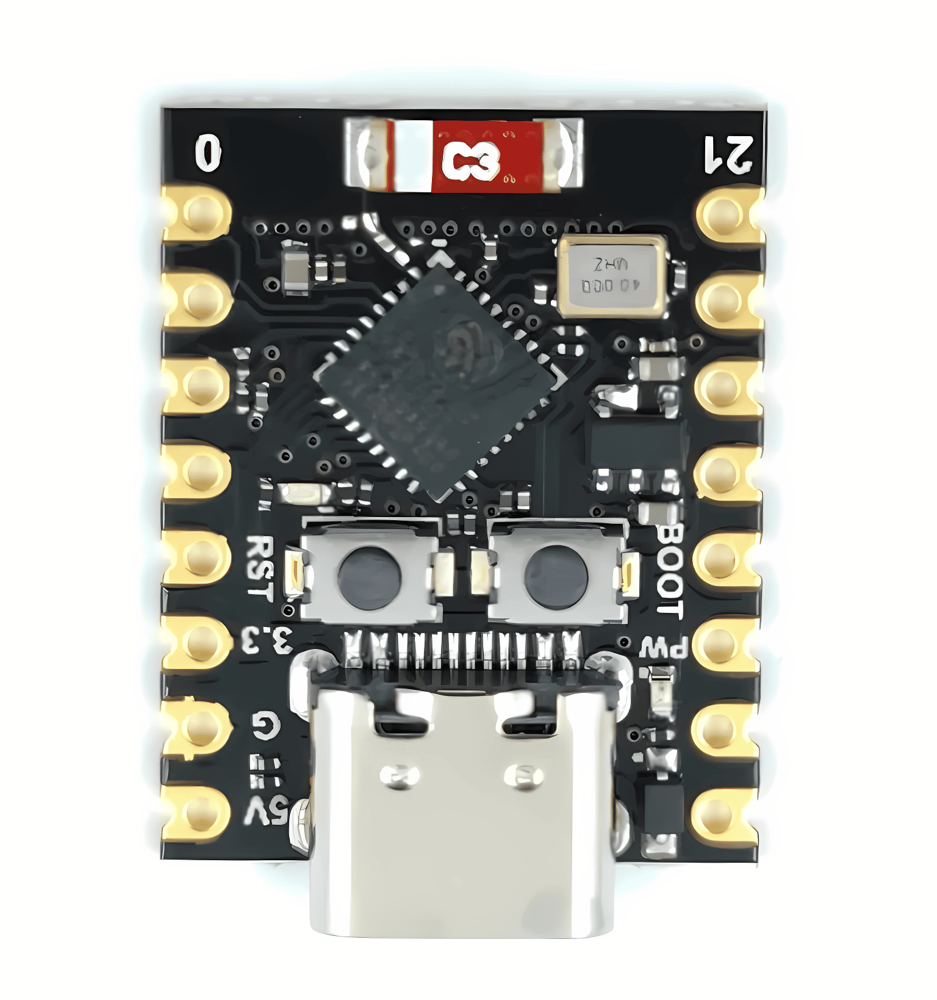

# ESP32-C3 SuperMini

{ align=left loading=lazy style="width:30%" }

Компактна плата на базі чипа ESP32-C3 із вбудованою керамічною антеною. Спеціальна збірка зі зниженою потужністю Wi-Fi передавача (`output_power: 8.5dB`) для забезпечення стабільного з'єднання на платах із конструктивними недоліками розведення.

!!! warning "Апаратна особливість та проблеми з Wi-Fi"
    У багатьох ревізіях плат **ESP32-C3 SuperMini** (особливо від сторонніх виробників) **кварцовий резонатор розташований занадто близько до керамічної Wi-Fi антени**, а також спостерігається нестабільне живлення під час пікових навантажень передавача. Через це при стандартній потужності (`19.5 dBm`–`20 dBm`) плата може:

    - не підключатися до роутера (помилка `Auth expired` у логах);
    - періодично «відвалюватися» від мережі під час передачі даних;
    - перегріватися.

### Як вирішується проблема:

1. **Програмне обмеження (реалізовано в цій збірці):**
   У конфігурації встановлено параметр `output_power: 8.5dB`. Зниження потужності передавача зменшує взаємні наводки між антеною та кварцом і знижує пікове споживання струму. У більшості випадків цього достатньо для стабільної роботи.
2. **Апаратне доопрацювання (якщо програмний метод не допоміг):**
   Якщо сигнал залишається занадто слабким або нестабільним, програмне зниження потужності може не дати результату. У такому разі рекомендується:

   - прибрати металеві предмети, дроти та контакти макетної плати подалі від зони антени (особливо біля пінів `GPIO20` та `GPIO21`);
   - випаяти штатну керамічну антену та припаяти до її контактного майданчика відрізок мідного дроту довжиною **~31–32 мм** (чвертьхвильовий штир для частоти 2.4 ГГц) або вигнуту дротяну антену.

Детальніше про порівняння ревізій та модифікацію антени можна почитати в обговореннях спільноти: [ESP32-C3 Super Mini WiFi Fix (Arduino Project Hub)](https://projecthub.arduino.cc/tarantula3/esp32-c3-super-mini-wifi-fix-3-methods-that-work-866a5e) та [обговорення на форумі Home Assistant](https://community.home-assistant.io/t/esp32-c3-super-mini-wifi-connection-problem/785228/).

!!! example "Конфігурація"
    * [Файл конфігурації](https://github.com/andrewjswan/svitlobot/blob/main/devices/c3-85-svitlobot.yaml)
    * [Прошивка](svitlobot-firmware.md)

!!! tip "Корисне"
    * [Документація ESP32-C3 SuperMini](https://www.espboards.dev/esp32/esp32-c3-super-mini/)

!!! tip "ESPHome: Adopt"
    [ESPHome: Інструкція з налаштування](adopt.md)
